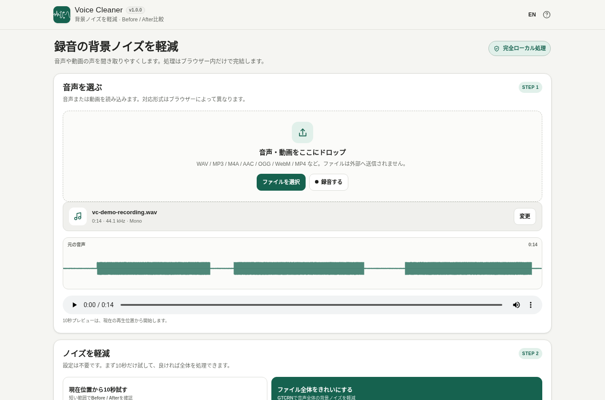

# Voice Cleaner / 音声ノイズ軽減

ブラウザーだけで録音の背景ノイズを軽減するツールです。GTCRNを端末内のWebAssemblyで動かし、入力した音声・動画をサーバーへアップロードしません。

## できること

- 録音済み音声・動画ファイルの読み込み（対応形式はブラウザーによって異なります）
- マイクから直接録音（権限・安全なコンテキストが必要）
- 再生位置から10秒間だけ試す／音声全体を処理
- 処理進捗・キャンセル
- 元音声と処理後の比較、波形表示
- 処理済み音声をWAV形式で保存（ファイル名を編集可能）
- PC・スマートフォン、日本語・英語の切り替え

## 使い方

1. 音声・動画を読み込むか、録音します。
2. 「現在位置から10秒試す」で効果を確認します。
3. 必要なら全体を処理し、同じ再生位置で聞き比べます。
4. 出力ファイル名を確認してWAVを保存します。

## プライバシーと制約

処理は端末内で完結し、入力・録音データは送信されません。単一HTML版はGTCRN WASM、JS、モデルを内包し、処理中の外部通信は不要です。CSPは `connect-src 'none'` を指定します。

出力は **16 kHz・モノラルWAV** です。高音質の音楽変換や複数人の声の分離、残響の完全除去には向きません。再生できるファイル形式はブラウザーのデコーダーに依存します。長時間音声は端末メモリ・処理速度の制約を受けます。

## 開発とビルド

Windowsで `./scripts/check-powershell-syntax.ps1` → `./scripts/check-repository.ps1` を実行してください。生成物は `dist/index.html`、`dist/index.self-extract.html`、`voice-cleaner.html`。依存パッケージは `dependencies.json` にバージョン固定し、`dependencies.lock.json` のSHA-256と照合します。生成ファイルは直接編集しません。

## ライセンス

本体MIT。GTCRN / gtcrn-wasm / PFFFTのライセンスは [THIRD_PARTY_NOTICES.md](THIRD_PARTY_NOTICES.md) に記載しています。
