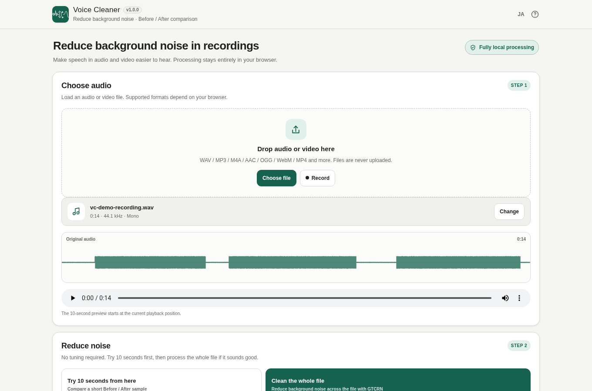

# Voice Cleaner

Reduce background noise in recorded speech, directly in your browser. GTCRN runs locally using WebAssembly; uploaded recordings and microphone data are not sent to a server.

## Features

- Open audio or video files supported by the browser's audio decoder
- Record from the microphone (permission and secure context required)
- Preview 10 seconds from the playhead or process the whole recording
- Progress indication and cancellation
- Compare original and cleaned audio at the same playback position
- Waveform previews and WAV export with editable filename
- Desktop/mobile layout; Japanese and English

## How to use

1. Choose an audio/video file or make a recording.
2. Run a 10-second preview.
3. Process the whole recording if needed, then switch between before and after.
4. Set the filename and save a WAV.

## Privacy and limitations

All input files, recordings, and inference stay on this device. The standalone HTML embeds the GTCRN WASM/JS/model assets and requires no runtime network; the page uses `connect-src 'none'`.

Processed files are **16 kHz mono WAV**. This is designed for intelligibility of speech recordings, not music mastering, speaker separation, or guaranteed elimination of strong reverberation. Decoding support depends on the browser; long recordings depend on device memory and processing speed.

## Build

On Windows run `./scripts/check-powershell-syntax.ps1` and `./scripts/check-repository.ps1`. Outputs are `dist/index.html`, `dist/index.self-extract.html`, and `voice-cleaner.html`. Dependencies are pinned in `dependencies.json` and SHA-256 locked in `dependencies.lock.json`. Do not edit generated files.

## License

MIT for the app. See [THIRD_PARTY_NOTICES.md](THIRD_PARTY_NOTICES.md) for GTCRN, gtcrn-wasm, and PFFFT notices.
